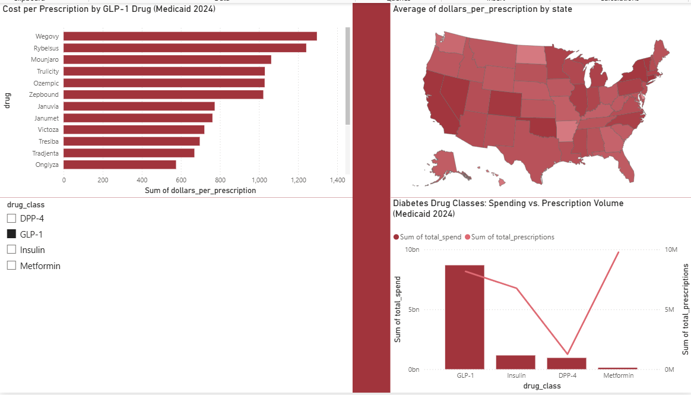

# 💊 Diabetes Drug Spend & Utilization Pipeline

An end-to-end ELT data pipeline analyzing Medicaid spending and utilization across four major diabetes drug classes (GLP-1 agonists, insulin, DPP-4 inhibitors, and metformin), with an automated FDA recall-monitoring layer.


## 📊 Key Finding

Across the four diabetes drug classes analyzed in Medicaid (2024), **GLP-1 agonists consumed about 80% of their combined spending (about $8.7B) despite metformin being the most-prescribed class** (9.8M prescriptions). Cost per prescription ranged from **$12.90 (metformin)** to **$1,063 (GLP-1)**, an 82x gap between the cheapest and most expensive classes.

*Scope: these four classes only. SGLT2 inhibitors (about $3.3B in a rough keyword check of the same data) and other diabetes classes are not included, so the 80% is GLP-1's share among these four, not among all diabetes drugs. Including SGLT2 would put it near 60%.*

| Drug Class | Prescriptions | Total Spend | Cost / Rx |
|------------|--------------:|------------:|----------:|
| GLP-1      | 8.2M          | $8.69B      | $1,063    |
| Insulin    | 6.8M          | $1.15B      | $170      |
| DPP-4      | 1.3M          | $0.95B      | $754      |
| Metformin  | 9.8M          | $0.13B      | $12.90    |

## 🏗️ Architecture

Medicaid SDUD API → Python extractor → PostgreSQL (raw) → dbt (staging + marts) → Power BI dashboard → n8n + Groq AI automation

- **Extract:** Python script pulls about 5.3M rows from the Medicaid SDUD API with pagination, timeouts and retries, and idempotent (truncate-reload) loading, plus a `--resume` flag to continue an interrupted load.
- **Load:** Raw data landed in PostgreSQL, untouched, all columns as text (ELT — transform in-warehouse).
- **Transform:** dbt models: a staging view (type casting, blank handling, national-total rows removed), a curated drug-class seed, a fact view joining the two, and class, drug, and state summary views.
- **Test:** 8 dbt data tests, including one that fails if national-total (`XX`) rows reach staging.
- **Visualize:** Power BI dashboard — cost-per-drug ranking, spend-vs-volume divergence by class, and a state-level choropleth.
- **Automate:** n8n workflow cross-references live openFDA drug recalls against the spend analysis and emails a styled briefing via Groq — with all figures computed in code so the LLM never fabricates numbers.

## 🔍 Data Engineering Highlights

- **NDC/name normalization:** Product names are dosage-fragmented (e.g. `OZEMPIC 1M`, `OZEMPIC 2M`); a keyword-based `LIKE` join collapses variants back to their parent drug.
- **Caught a 2x inflation bug:** The SDUD `XX` code represents national totals that duplicate state-level rows. Verification via row counts caught the double-count before it reached the dashboard; filtered at the staging layer.
- **LLM fabrication guardrail:** All numbers are pre-computed in code and passed to the LLM as finished facts. The model writes prose only — it never performs arithmetic or generates figures.
- **Enforced the fix with a test:** a dbt test now fails if any `XX` national-total row reaches staging, so the 2x inflation bug cannot return silently.

## 🛠️ Tech Stack

Python · PostgreSQL · dbt · Power BI · n8n · Groq (Llama 3.3) · openFDA API · Medicaid SDUD

## 📁 Repo Structure

- `extract_sdud.py`: API extractor (supports `--resume`)
- `sql/create_raw_tables.sql`: raw table DDL
- `.env.example`: database settings template
- `diabetes_dbt/`: dbt project (models, seed, tests)
- `n8n_automation/`: n8n workflow export
- `requirements.txt`: Python dependencies

## 📈 Dashboard



## Run It Yourself

```powershell
git clone https://github.com/ang3lmbenoun/diabetes-glp1-pipeline.git
cd diabetes-glp1-pipeline
python -m venv venv
.\venv\Scripts\Activate.ps1
pip install -r requirements.txt
```

1. Create a Postgres database, then run `sql/create_raw_tables.sql` in it.
2. Copy `.env.example` to `.env` and fill in your database credentials.
3. Load the data (about 5.3M rows): `python extract_sdud.py`. Use `--resume` to continue an interrupted load.
4. Add a profile named `diabetes_dbt` to your dbt `profiles.yml`, pointing at your database with schema `analytics`.
5. Build and test:

```powershell
cd diabetes_dbt
dbt seed
dbt run
dbt test
```

A clean run ends with 8 passing tests.

## 📝 Data Source

[Medicaid State Drug Utilization Data (SDUD)](https://data.medicaid.gov/) · [openFDA Drug Enforcement API](https://open.fda.gov/)

---
*Built by Angel Mbenoun♡ · Aug 2026*
